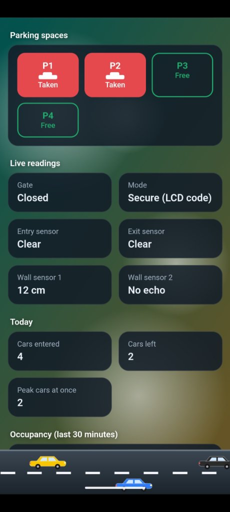
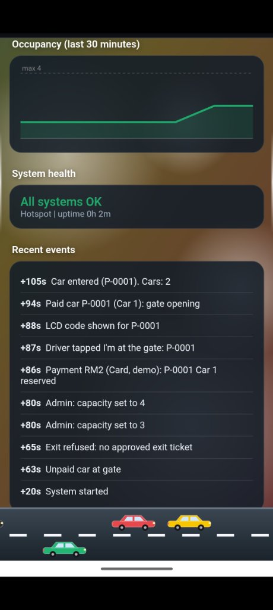
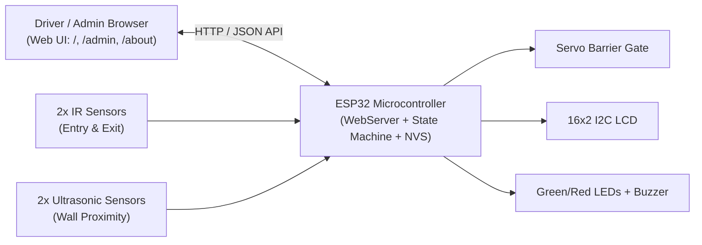

# IoT Smart Parking System (ESP32)

An ESP32-powered IoT smart parking management system featuring automated barrier gate control, ticketed entry/exit verification, tailgating & wall-proximity alerts, NVS persistent analytics, and a real-time bilingual (English / Bahasa Melayu) web dashboard hosted directly on the microcontroller.

> **Live Interactive Demo:** [Try the web dashboard in your browser →](https://danmadinah.github.io/IOT-Based-Smart-Parking-System/)  
> *(Runs an in-browser ESP32 simulator so you can test reservations, gate animations, Secure LCD codes, and the Admin panel without hardware.)*

## Prototype & Live Dashboard

| Hardware Prototype | Live Dashboard & Tickets | Parking Spaces & Sensors | Analytics & Event Log |
| :---: | :---: | :---: | :---: |
|  |  |  |  |

## Key Features

- **Automated Barrier & Safe-Close Gate**: Smooth servo-controlled barrier with obstruction detection that automatically re-opens if an IR sensor is triggered while closing.
- **Demo Payment & Reservation Flow**: Drivers reserve a spot (RM2 demo fee), arm the gate when arriving ("I'm at the gate"), and tap "I'm exiting" to leave—with automatic expiry and cancellation refunds.
- **Two-Factor Entry (Secure Mode)**: Optional 4-digit dynamic code displayed on the 16x2 I2C LCD with progressive lockouts (30s → 2m → 5m) and per-IP cooldowns after repeated failed attempts.
- **Security & Safety Monitoring**:
  - **Tailgating Detection**: Detects a second vehicle closely following an authorized entry, holds the gate open safely, raises an alarm, and updates the car count accurately.
  - **Wall-Proximity Warning**: Dual HC-SR04 ultrasonic sensors trigger a buzzer warning when a vehicle gets too close (`< 6 cm`).
  - **Sensor Health Diagnostics**: Detects stuck IR sensors, weak Wi-Fi RSSI, and low heap memory.
- **Real-Time Web Dashboard & Admin Panel**:
  - Animated SVG parking lot scene, live slot map, 30-minute occupancy chart, dark/light mode, and EN/BM language toggle.
  - HTTP Basic Auth `/admin` panel with manual gate override, capacity adjustment, buzzer mute, CSV log export, and a built-in **45-second full hardware demo mode**.
- **Zero-Cloud Reliability**: Connects to 2.4 GHz Wi-Fi with mDNS (`http://danmadinah.local`) and NTP timestamps, and automatically falls back to a local SoftAP hotspot (`192.168.4.1`) if Wi-Fi is unavailable.

## System Architecture



## Project Structure

```text
smart-parking-esp32/
├── firmware/
│   └── smart_parking/
│       ├── smart_parking.ino   # Entry point, setup() & main state machine loop()
│       ├── config.example.h    # Wi-Fi, hotspot, admin & pin configuration template
│       ├── state.h             # Shared structs, enums & runtime state declarations
│       ├── hardware.h / .cpp   # IR debounce filter, servo gate, ultrasonic, LCD, LEDs, buzzer
│       ├── parking.h / .cpp    # Reservations, tickets, LCD codes, cooldowns, logs & NVS stats
│       ├── demo.h / .cpp       # Single simulations & 45-second full hardware demo
│       ├── web_api.h / .cpp    # REST API endpoints, admin controls & CSV export
│       └── web_pages.h         # Bundled PROGMEM web assets (generated from web/)
├── web/
│   ├── index.html              # Live driver dashboard
│   ├── admin.html              # Admin control panel
│   ├── about.html              # About & project scope page
│   ├── css/                    # Separated stylesheets (dashboard, admin, about)
│   └── js/                     # Separated frontend scripts (dashboard, admin)
├── scripts/
│   └── build_web_header.py     # Bundles web/ into firmware/smart_parking/web_pages.h
├── docs/
│   ├── images/                 # Hardware prototype & dashboard screenshots
│   ├── WIRING.md               # Hardware list & ESP32 GPIO pinout
│   ├── SETUP.md                # Arduino IDE setup, libraries & flashing guide
│   └── API.md                  # REST API reference
├── .gitignore
├── LICENSE
└── README.md
```

## Quick Start

1. **Wire the hardware** following [docs/WIRING.md](docs/WIRING.md).
2. **Create your config**: Copy `firmware/smart_parking/config.example.h` to `firmware/smart_parking/config.h` and set your Wi-Fi and admin password.
3. **Flash the ESP32**: Open `firmware/smart_parking/smart_parking.ino` in Arduino IDE, install `LiquidCrystal I2C` and `ESP32Servo`, and click **Upload**. See [docs/SETUP.md](docs/SETUP.md) for full instructions.
4. **Open the dashboard**: Visit `http://danmadinah.local` (or the IP shown on the LCD / Serial Monitor).

## Documentation

- [Hardware & Wiring Guide](docs/WIRING.md)
- [Setup & Flashing Guide](docs/SETUP.md)
- [REST API Reference](docs/API.md)

## Author

- **Student:** Muhammad Abdullahi Bukar
- **Supervisor:** Mohd Zaki Shahabuddin

## License

This project is licensed under the MIT License — see [LICENSE](LICENSE) for details.
