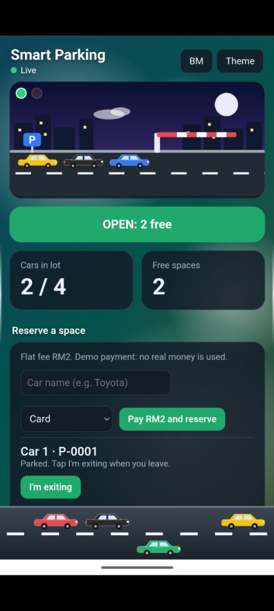
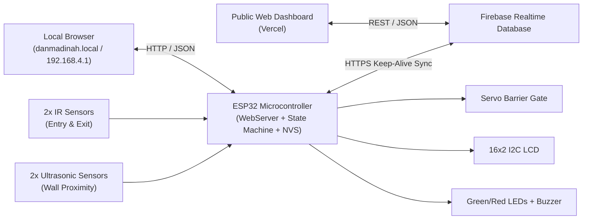

# IoT Smart Parking System (ESP32)

An ESP32-powered IoT smart parking management system featuring automated barrier gate control, ticketed entry/exit verification, tailgating & wall-proximity alerts, NVS persistent analytics, live Firebase Realtime Database cloud sync (Vercel), and a real-time bilingual (English / Bahasa Melayu) web dashboard.

## Prototype & Live Dashboard

| Hardware Prototype | Live Dashboard & Tickets | Parking Spaces & Sensors | Analytics & Event Log |
| :---: | :---: | :---: | :---: |
|  |  |  |  |

## Key Features

- **Automated Barrier & Safe-Close Gate**: Smooth servo-controlled barrier with obstruction detection that automatically re-opens if an IR sensor is triggered while closing.
- **Demo Payment & Reservation Flow**: Drivers reserve a spot (RM2 demo fee), arm the gate when arriving ("I'm at the gate"), and tap "I'm exiting" to leave—with automatic expiry and cancellation refunds.
- **Two-Factor Entry (Secure Mode)**: Optional 4-digit dynamic code displayed on the 16x2 I2C LCD with progressive lockouts (30 s → 2 min → 5 min) and per-IP cooldowns after repeated failed attempts.
- **Security & Safety Monitoring**:
  - **Tailgating Detection**: Detects a second vehicle closely following an authorized entry, holds the gate open safely, raises an alarm, and updates the car count accurately.
  - **Wall-Proximity Warning**: Dual HC-SR04 ultrasonic sensors trigger a buzzer warning when a vehicle gets too close (`< 6 cm`).
  - **Sensor Health Diagnostics**: Detects stuck IR sensors, weak Wi-Fi RSSI, and low heap memory.
- **Real-Time Web Dashboard & Admin Panel**:
  - Animated SVG parking lot scene, live slot map, 30-minute occupancy chart, dark/light mode, and EN/BM language toggle.
  - Password-protected `/admin` panel (HTTP Basic Auth locally, ESP32-verified login on Vercel) with manual gate override, capacity adjustment, buzzer mute, CSV log export, and a built-in **45-second full hardware presentation mode**.
- **Dual Connectivity (Cloud + Offline Fallback)**: Connects to 2.4 GHz Wi-Fi with mDNS (`http://danmadinah.local`), NTP timestamps, and live Firebase Realtime Database sync for Vercel—and automatically falls back to a standalone SoftAP hotspot (`DanMadinah-Lot` / `192.168.4.1`) if Wi-Fi is unavailable.

## Security Model (Five Layers)

| Layer | What It Checks | What It Stops |
| :--- | :--- | :--- |
| **1. Network & Admin Auth** | Local Wi-Fi / SoftAP access; ESP32-verified admin password for cloud commands | Unauthorized remote control |
| **2. Payment (Demo)** | No payment means no reservation token | Free-riders |
| **3. Arrival Tap** | "I'm at the gate" within 20 s | Tickets used at the wrong time |
| **4. One-Time LCD Code** | 4-digit code shown only on the LCD (20 s, single-use) in Secure Mode | Remote entry without being at the gate |
| **5. Escalating Lockout** | 3 wrong codes lock (30 s → 2 min → 5 min); 6 cancel + 2-minute cooldown | Code guessing |

Exit is protected as well: each parked car has its own ticket and must be armed with **"I'm exiting"** (or approved by an Admin) before the gate opens. See the full threat & response table in [docs/SECURITY.md](docs/SECURITY.md).

## System Architecture



## System Flowcharts

| Overall System Flow | Driver, Payment & Security Flow |
| :---: | :---: |
|  |  |

## Project Structure

```text
IOT-Based-Smart-Parking-System/
├── firmware/
│   └── smart_parking/
│       ├── smart_parking.ino   # Entry point, setup(), Wi-Fi/Hotspot & state machine loop()
│       ├── config.example.h    # Wi-Fi, hotspot, admin, Firebase & pin config template
│       ├── state.h             # Shared structs, enums & runtime state declarations
│       ├── hardware.h / .cpp   # IR debounce filter, servo gate, ultrasonic, LCD, LEDs, buzzer
│       ├── parking.h / .cpp    # Reservations, tickets, LCD codes, cooldowns, logs & NVS stats
│       ├── demo.h / .cpp       # Admin presentation simulations & 45-second hardware demo
│       ├── web_api.h / .cpp    # Local REST API, remote command dispatcher & CSV export
│       ├── firebase_sync.h/.cpp# Persistent HTTPS Keep-Alive sync with Firebase RTDB
│       └── web_pages.h         # Bundled PROGMEM web assets (generated from web/)
├── web/
│   ├── index.html              # Live driver dashboard
│   ├── admin.html              # Admin control panel
│   ├── about.html              # About & project scope page
│   ├── css/                    # Separated stylesheets (dashboard, admin, about)
│   └── js/                     # dashboard.js, admin.js, firebase-bridge.js, firebase-config.js
├── scripts/
│   └── build_web_header.py     # Bundles web/ into firmware/smart_parking/web_pages.h
├── docs/
│   ├── images/                 # Hardware prototype & dashboard screenshots
│   ├── WIRING.md               # Hardware list & ESP32 GPIO pinout
│   ├── SETUP.md                # Arduino IDE setup, libraries & flashing guide
│   ├── FIREBASE_SETUP.md       # Firebase Realtime Database + Vercel cloud sync guide
│   ├── SECURITY.md             # Five-layer security model & detection matrix
│   └── API.md                  # REST API reference
├── vercel.json                 # Vercel static deployment config (serves web/)
├── .gitignore
├── LICENSE
└── README.md
```

## Quick Start

1. **Wire the hardware** following [docs/WIRING.md](docs/WIRING.md).
2. **Create your config**: Copy `firmware/smart_parking/config.example.h` to `firmware/smart_parking/config.h` and set your Wi-Fi, admin password, and optional `FIREBASE_DB_URL`.
3. **Flash the ESP32**: Open `firmware/smart_parking/smart_parking.ino` in Arduino IDE, install `LiquidCrystal I2C` and `ESP32Servo`, and click **Upload**. See [docs/SETUP.md](docs/SETUP.md).
4. **Open the dashboard**:
   - **Local Wi-Fi**: Visit `http://danmadinah.local` (or the IP shown on the LCD / Serial Monitor).
   - **Offline Hotspot**: Connect to `DanMadinah-Lot` (`parking123`) and visit `http://192.168.4.1`.
   - **Public Cloud (Vercel)**: Configure Firebase following [docs/FIREBASE_SETUP.md](docs/FIREBASE_SETUP.md).

## Test Plan and Results

**Test Environment:** ESP32 Dev Module · Arduino IDE 2.3.x · 2.4 GHz Wi-Fi / SoftAP Hotspot (`DanMadinah-Lot`) · Mobile Chrome & Firebase Realtime Database (`asia-southeast1`).

| ID | Scenario | Steps | Expected Result | Result |
| :--- | :--- | :--- | :--- | :---: |
| T1 | Paid car enters | Pay, tap "I'm at the gate", drive in | Gate opens, car counted, ticket shows Parked | ✅ |
| T2 | Unpaid car | Trigger entry sensor with no ticket | Gate stays shut, red LED blinks, 2 beeps, alert | ✅ |
| T3 | Paid but no tap | Pay, trigger entry sensor, do not tap | Reminder, then alert after 8 s | ✅ |
| T4 | Lot full | Fill the lot, try again | Entry refused, red LED on | ✅ |
| T5 | Payment when full | Pay while the lot is full | "Lot full" message, no ticket | ✅ |
| T6 | Reservation expiry | Pay, wait 60 s | Space released, refund message | ✅ |
| T7 | Cancel | Pay, tap Cancel | Space released at once | ✅ |
| T8 | Wrong codes (secure mode) | Enter 3 wrong codes | Ticket locked 30 s, LCD shows `LOCKED` | ✅ |
| T9 | Ticket cancelled | Enter 6 wrong codes in total | Ticket cancelled, alert, 2-minute cooldown | ✅ |
| T10 | Tailgating | Second car follows a paid car | Gate held open, alarm, alert | ✅ |
| T11 | Exit with ticket | Tap "I'm exiting", drive out | Gate opens, ticket marked Left, count -1 | ✅ |
| T12 | Exit without ticket | Trigger exit sensor with no armed ticket | Gate stays shut, alert | ✅ |
| T13 | Wall warning | Move a car within 6 cm of a wall sensor | Buzzer sounds | ✅ |
| T14 | Gate obstruction | Block the gate while it closes | Gate re-opens | ✅ |
| T15 | Restart persistence | Press EN | Count, statistics and settings remain | ✅ |
| T16 | Hotspot fallback | Start with no home Wi-Fi available | ESP32 starts the `DanMadinah-Lot` hotspot | ✅ |
| T17 | Multi-car on one phone | Reserve four cars with different names | Four tickets listed; each exits separately | ✅ |

## Known Limitations

- Payment is a **simulation** (no real money, no live payment gateway).
- Local HTTP Basic Auth is plain HTTP (intended for private networks); remote cloud commands are verified by the ESP32 via HTTPS to Firebase.
- The event log and 30-minute occupancy chart live in RAM and reset on power cycle; car count, statistics, and settings persist in ESP32 NVS flash.
- The system verifies payment, physical presence, and tickets—**not vehicle identity** (a number-plate camera or RFID reader is planned future work).

## Lessons Learned

### Hardware
- **Breadboard fit**: The ESP32 dev board leaves only left-hand breadboard holes accessible, so all signal wiring was routed to left-side GPIO pins.
- **Dedicated servo power**: Powering the servo from 3.3 V or a shared USB rail caused voltage dips and LCD flickering; using a dedicated 5 V supply with a common ground solved it.
- **LCD & ultrasonic voltage levels**: A BSS138 level shifter allows the 5 V I2C LCD to run brightly with the 3.3 V ESP32; shifting the 5 V ultrasonic Echo lines is a planned refinement.
- **IR sensor tuning**: IR obstacle sensors are sensitive to dark/glossy surfaces and ambient light; shading, level alignment, software debouncing, and release delays significantly improved reliability.

### Software & Deployment
- **Single-threaded ESP32 WebServer**: Keeping the loop non-blocking, disabling Wi-Fi sleep, and reusing a persistent HTTPS Keep-Alive socket for Firebase prevented the web server and gate loop from starving each other.
- **Reliable live demos**: Keeping a dedicated 2.4 GHz hotspot fallback (`DanMadinah-Lot`) ensures the prototype works cleanly even on restricted exhibition Wi-Fi networks.

## Documentation

- [Hardware & Wiring Guide](docs/WIRING.md)
- [Setup & Flashing Guide](docs/SETUP.md)
- [Firebase Cloud Sync Setup](docs/FIREBASE_SETUP.md)
- [Security Design](docs/SECURITY.md)
- [REST API Reference](docs/API.md)

## Authors

- **Muhammad Abdullahi Bukar**
- **Supervisor:** Mohd Zaki Shahabuddin, Universiti Islam Antarabangsa Tuanku Syed Sirajuddin (UNISIRAJ)

## Recognition

- **Bronze Medal** at **UniSID** (UNISIRAJ International Innovation, Invention and Design).

## License

This project is licensed under the MIT License — see [LICENSE](LICENSE) for details.
