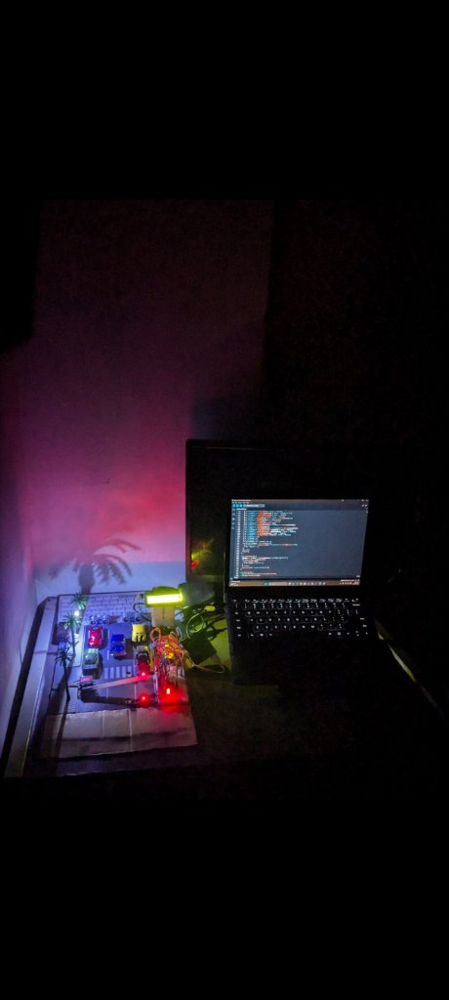
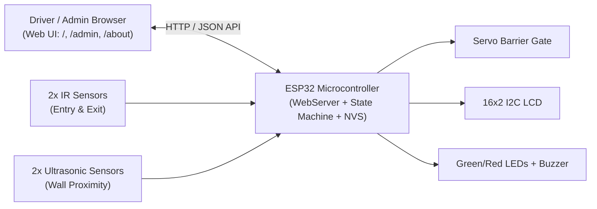

# IoT Smart Parking System (ESP32)

An ESP32-powered IoT smart parking management system featuring automated barrier gate control, ticketed entry/exit verification, tailgating & wall-proximity alerts, NVS persistent analytics, and a real-time bilingual (English / Bahasa Melayu) web dashboard hosted directly on the microcontroller.

> **Live Interactive Demo:** [Try the web dashboard in your browser →](https://danmadinah.github.io/IOT-Based-Smart-Parking-System/)  
> *(Runs an in-browser ESP32 simulator so you can test reservations, gate animations, Secure LCD codes, and the Admin panel without hardware.)*

## Prototype & Live Dashboard

| Hardware Prototype | Live Dashboard & Tickets | Parking Spaces & Sensors | Analytics & Event Log |
| :---: | :---: | :---: | :---: |
|  |  |  |  |

## Key Features

- **Automated Barrier & Safe-Close Gate**: Smooth servo-controlled barrier with obstruction detection that automatically re-opens if an IR sensor is triggered while closing.
- **Demo Payment & Reservation Flow**: Drivers reserve a spot (RM2 demo fee), arm the gate when arriving ("I'm at the gate"), and tap "I'm exiting" to leave—with automatic expiry and cancellation refunds.
- **Two-Factor Entry (Secure Mode)**: Optional 4-digit dynamic code displayed on the 16x2 I2C LCD with progressive lockouts (30s → 2m → 5m) and per-IP cooldowns after repeated failed attempts.
- **Security & Safety Monitoring**:
  - **Tailgating Detection**: Detects a second vehicle closely following an authorized entry, holds the gate open safely, raises an alarm, and updates the car count accurately.
  - **Wall-Proximity Warning**: Dual HC-SR04 ultrasonic sensors trigger a buzzer warning when a vehicle gets too close (`< 6 cm`).
  - **Sensor Health Diagnostics**: Detects stuck IR sensors, weak Wi-Fi RSSI, and low heap memory.
- **Real-Time Web Dashboard & Admin Panel**:
  - Animated SVG parking lot scene, live slot map, 30-minute occupancy chart, dark/light mode, and EN/BM language toggle.
  - HTTP Basic Auth `/admin` panel with manual gate override, capacity adjustment, buzzer mute, CSV log export, and a built-in **45-second full hardware demo mode**.
- **Zero-Cloud Reliability**: Connects to 2.4 GHz Wi-Fi with mDNS (`http://danmadinah.local`) and NTP timestamps, and automatically falls back to a local SoftAP hotspot (`192.168.4.1`) if Wi-Fi is unavailable.

# Security Design

## Goal
Allow a vehicle into (and out of) a private, paid car park only when a valid, paid ticket exists and the driver is physically at the gate. Raise visible alerts when rules are broken.

## Layers
1. **On-site Wi-Fi.** The payment page is served by the ESP32 on the lot's local network.
2. **Payment (demo).** A flat RM2 fee creates a ticket and reserves a space for 60 seconds. Unused or cancelled tickets are refunded (simulated).
3. **Arrival confirmation.** The driver taps "I'm at the gate" within 20 s of reaching the entry sensor.
4. **One-time LCD code (secure mode).** A random 4-digit code appears only on the LCD, is valid for 20 s and works once. It is accepted only together with the ticket's secret token held in the driver's browser.
5. **Escalating response.** Per ticket: 3 wrong codes lock the ticket (30 s, then 2 min, then 5 min). 6 wrong codes in total cancel the ticket (demo refund), raise a security alert, and block that phone from paying for 2 minutes.

## Detection and response
| Event | Response |
|---|---|
| Unpaid car at the gate | Gate stays shut, red LED blinks, 2 beeps, alert |
| Paid driver did not tap | Reminder first (1 beep, green LED blinks), alert after 8 s |
| Lot full | Entry refused, red LED on, payment refused |
| Tailgating (second car follows) | Gate held open, buzzer pulses, red LED blinks, alert; ends when the follower has passed or the admin clears it |
| Exit without an approved ticket | Gate stays shut, red LED blinks, 2 beeps, alert; the admin can approve one exit |
| Something blocks the closing gate | Gate re-opens |
| Car too close to the wall | Buzzer warning below 6 cm |

## Admin
Password-protected (HTTP Basic Auth). Functions: manual gate control, approve an exit, reset and restart, capacity, simple or secure mode, mute the buzzer, demo mode, security alerts panel, CSV log, demo revenue.

## Honest limits
- Plain HTTP, no encryption. Use only on a private network.
- Identity is the ticket and the phone, not the vehicle. A thief who has the driver's phone and the car passes the checks. A number-plate camera or RFID tag would address this.
- Tickets and logs are held in RAM and reset on restart.
- The IR sensors can misread dark or shiny cars and react to bright light and reflections.
- Do not claim "unhackable" or "100% secure". Describe it as layered, defence in depth for a prototype.

## Before any real deployment
HTTPS, a real payment gateway handled off the ESP32, number-plate or RFID identification, permanent audit logs, and a systematic security test.
## Security Model: five layers

| Layer | What it checks | What it stops |
|---|---|---|
| 1. On-site Wi-Fi | Only phones on the lot's network reach the payment page | Outsiders |
| 2. Payment | No payment means no reservation | Free-riders |
| 3. Arrival tap | "I'm at the gate" within 20 s | Tickets used at the wrong time |
| 4. One-time LCD code (secure mode) | A 4-digit code shown only on the LCD, valid 20 s, used once | Someone who is not physically at the gate |
| 5. Escalating response | 3 wrong codes lock the ticket (30 s, 2 min, 5 min); 6 cancel it and block that phone from paying for 2 min | Code guessing |

Exit is protected too: each car has its own ticket and must be armed with "I'm exiting" before the gate opens for it.
Details: [docs/SECURITY.md](docs/SECURITY.md)
## System Architecture



## System Flowcharts

| Overall system flow | Driver, payment and security flow |
|---|---|
|  |  |


## Project Structure

```text
smart-parking-esp32/
├── firmware/
│   └── smart_parking/
│       ├── smart_parking.ino   # Entry point, setup() & main state machine loop()
│       ├── config.example.h    # Wi-Fi, hotspot, admin & pin configuration template
│       ├── state.h             # Shared structs, enums & runtime state declarations
│       ├── hardware.h / .cpp   # IR debounce filter, servo gate, ultrasonic, LCD, LEDs, buzzer
│       ├── parking.h / .cpp    # Reservations, tickets, LCD codes, cooldowns, logs & NVS stats
│       ├── demo.h / .cpp       # Single simulations & 45-second full hardware demo
│       ├── web_api.h / .cpp    # REST API endpoints, admin controls & CSV export
│       └── web_pages.h         # Bundled PROGMEM web assets (generated from web/)
├── web/
│   ├── index.html              # Live driver dashboard
│   ├── admin.html              # Admin control panel
│   ├── about.html              # About & project scope page
│   ├── css/                    # Separated stylesheets (dashboard, admin, about)
│   └── js/                     # Separated frontend scripts (dashboard, admin)
├── scripts/
│   └── build_web_header.py     # Bundles web/ into firmware/smart_parking/web_pages.h
├── docs/
│   ├── images/                 # Hardware prototype & dashboard screenshots
│   ├── WIRING.md               # Hardware list & ESP32 GPIO pinout
│   ├── SETUP.md                # Arduino IDE setup, libraries & flashing guide
│   └── API.md                  # REST API reference
├── .gitignore
├── LICENSE
└── README.md
```

## Quick Start

1. **Wire the hardware** following [docs/WIRING.md](docs/WIRING.md).
2. **Create your config**: Copy `firmware/smart_parking/config.example.h` to `firmware/smart_parking/config.h` and set your Wi-Fi and admin password.
3. **Flash the ESP32**: Open `firmware/smart_parking/smart_parking.ino` in Arduino IDE, install `LiquidCrystal I2C` and `ESP32Servo`, and click **Upload**. See [docs/SETUP.md](docs/SETUP.md) for full instructions.
4. **Open the dashboard**: Visit `http://danmadinah.local` (or the IP shown on the LCD / Serial Monitor).

## Known Limitations
- Payment is a **simulation** (no real money, no payment gateway).
- The real dashboard is served by the ESP32 and works **only on the local Wi-Fi**. The public demo page uses simulated data.
- The admin page uses plain HTTP Basic Auth (acceptable on a private network, not on the open internet).
- The event log and chart live in RAM and reset on restart. Car count, statistics and settings persist.
- The system verifies payment, presence and tickets, **not which vehicle** is at the gate (a number-plate camera is future work).
- The ESP32 web server answers one request at a time, so it suits a few phones, not a crowd.

## Testing and Lessons Learned
# Test Plan and Results

| ID | Scenario | Steps | Expected result | Result (pass/fail, n/n) | Notes |
|---|---|---|---|---|---|
| T1 | Paid car enters | Pay, tap "I'm at the gate", drive in | Gate opens, car counted, ticket shows Parked |✅ | |
| T2 | Unpaid car | Trigger the entry sensor with no ticket | Gate stays shut, red LED blinks, 2 beeps, alert | | |
| T3 | Paid but no tap | Pay, trigger the entry sensor, do not tap | Reminder, then alert after 8 s | | |
| T4 | Lot full | Fill the lot, try again | Entry refused, red LED on | | |
| T5 | Payment when full | Pay while the lot is full | "Lot full" message, no ticket | | |
| T6 | Reservation expiry | Pay, wait 60 s | Space released, refund message | | |
| T7 | Cancel | Pay, tap Cancel | Space released at once | | |
| T8 | Wrong codes (secure mode) | 3 wrong codes | Ticket locked 30 s, LCD shows LOCKED | | |
| T9 | Ticket cancelled | 6 wrong codes in total | Ticket cancelled, alert, 2-minute payment block | | |
| T10 | Tailgating | Second car follows a paid car | Gate held open, alarm, alert | | |
| T11 | Exit with ticket | Tap "I'm exiting", drive out | Gate opens, ticket marked Left, count -1 | | |
| T12 | Exit without ticket | Trigger the exit sensor with no armed ticket | Gate stays shut, alert | | |
| T13 | Wall warning | Move a car within 6 cm of a wall sensor | Buzzer sounds | | |
| T14 | Gate obstruction | Block the gate while it closes | Gate re-opens | | |
| T15 | Restart persistence | Press EN | Count, statistics and settings remain | | |
| T16 | Hotspot fallback | Start with a wrong Wi-Fi name | ESP32 starts the DanMadinah-Lot hotspot | | |
| T17 | Multi-car on one phone | Reserve four cars with different names | Four tickets listed; each exits separately | | |

## Test environment
Date, location, Wi-Fi (home router or phone hotspot), number of phones connected, ESP32 board and firmware version.

# Lessons Learned

## Hardware
- **The ESP32 is wider than the breadboard allows.** Only the left-hand pins had a free hole beside them, so all signals were moved to left-side pins.
- **The servo needs its own 5 V.** Powered from 3.3 V it hummed and stalled. A separate 5 V supply with a common ground fixed it.
- **The LCD is dim at 3.3 V.** A BSS138 level shifter lets it run at 5 V while the ESP32 stays at 3.3 V.
- **Ultrasonic Echo signals are 5 V.** The Echo pins are not level-shifted yet; the two spare shifter channels are the planned fix.
- **IR obstacle sensors are unreliable on dark, shiny or small cars** and react to bright light. Fixes: shade the sensors, aim them level across the lane, tune the dial, add a release delay in software, and use a reflective strip on dark cars.
- **Loose breadboard wires cause most "software" problems.** Check wires first.

## Software
- The ESP32 web server answers **one request at a time**. Polling had to be slowed, Wi-Fi sleep turned off, and long delays avoided so the gate loop does not starve the website.
- Browsers cache old pages: send a no-cache header when the page changes.
- Arduino requires shared types to be declared before the functions that use them.
- A security feature needs a **state** (alarm hold), not just a one-off event.

## Deployment
- A locally hosted website depends on the network. At the live event, a crowded or isolated Wi-Fi caused problems.
- Next time: bring a dedicated router or use a phone hotspot, reserve a fixed IP for the ESP32, keep the dashboard open on one device, and prepare a screen-recorded backup of the whole flow.

## Next steps
Real payment gateway, number-plate camera or RFID, HTTPS, an asynchronous web server, permanent log storage, and remote access.
## Documentation

- [Hardware & Wiring Guide](docs/WIRING.md)
- [Setup & Flashing Guide](docs/SETUP.md)
- [REST API Reference](docs/API.md)

## Authors
- **Muhammad Abdullahi Bukar**
- **Supervisor:** Mohd Zaki Shahabuddin, Universiti Islam Antarabangsa Tuanku Syed Sirajuddin (UNISIRAJ)

## Recognition
Bronze medal at UniSID (UNISIRAJ International Innovation, Invention and Design).
## License

This project is licensed under the MIT License — see [LICENSE](LICENSE) for details.
